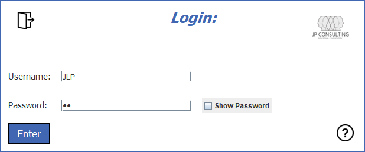
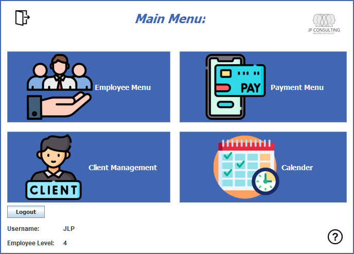
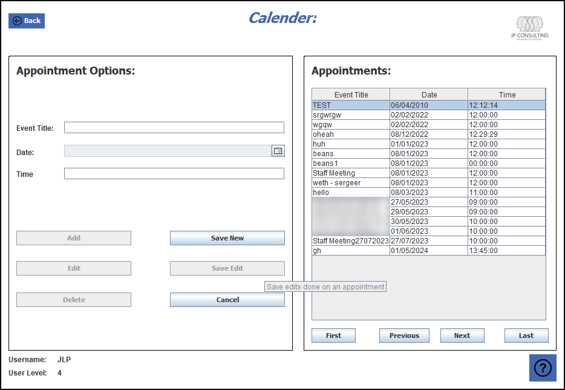
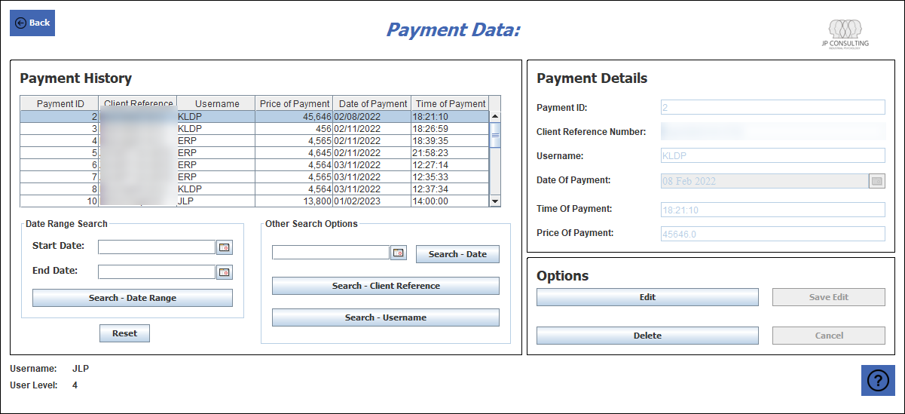
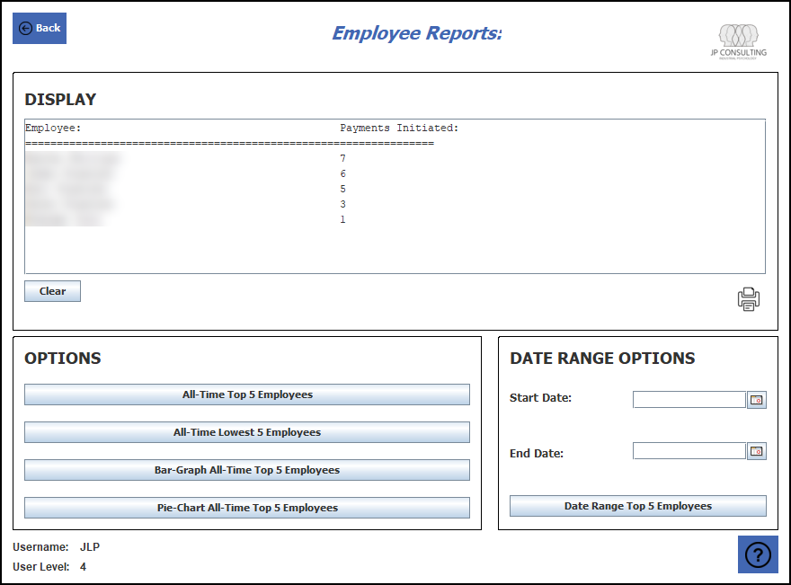

# Business Management System

A Java desktop application for running a small service business: client and employee records, bookings, checkout and reports, backed by a Microsoft Access database.

Built for my matric (Grade 12) Information Technology Practical Assessment Task at Crawford International in 2023. It grew out of a smaller Grade 11 prototype and was developed in four documented phases, from design to testing.

## Features

- **Login with role-based access** – what an employee can see depends on their employee level
- **Client management** – add, edit and look up client records
- **Employee management** – staff records, positions and activity status
- **Booking calendar** – schedule and view appointments
- **Checkout** – card and Zapper payment options
- **Payment history** – filter payments by date range, client or employee
- **Employee reports** – charted summaries generated from SQL queries
- **Help screens** with text and video guides, plus input validation

## How it's built

| Layer | Details |
|---|---|
| GUI (`src/GUI`) | Java Swing forms built in NetBeans: login, menus, checkout, calendar, reports |
| Data (`src/Data`) | Model classes plus a `*Data` class per table that runs the SQL and fills the tables |
| Database | Microsoft Access (`.mdb`) via JDBC and the UCanAccess driver, wrapped in `dbManager` |

## Running it

1. Open the project in NetBeans (JDK 8+).
2. Add the UCanAccess JARs to the project libraries.
3. Place an Access database with the expected tables next to the project. The original database isn't included because it holds sample personal data.
4. Run `GUI/Login.java`.

## What I'd do differently now

Looking back at this as a third-year CS student:

- Use **prepared statements** instead of string-built SQL, to prevent SQL injection
- **Hash passwords** instead of storing them as plain text
- Separate data access from the UI more cleanly, and add unit tests
- Use a portable database such as SQLite instead of Access

## Screenshots

Sample data only. Personal details are blurred.

| Login | Main menu |
|---|---|
|  |  |

**Booking calendar**

**Payment history with date-range and reference search**

**Employee reports with bar and pie charts**

